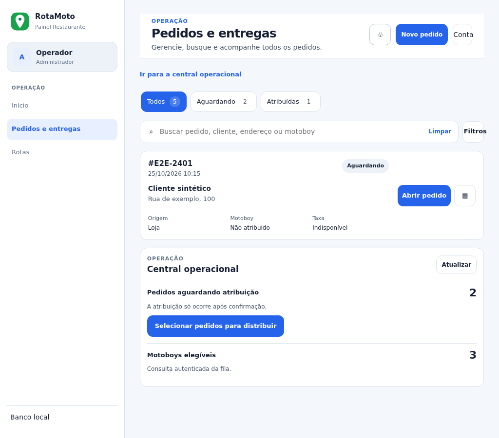
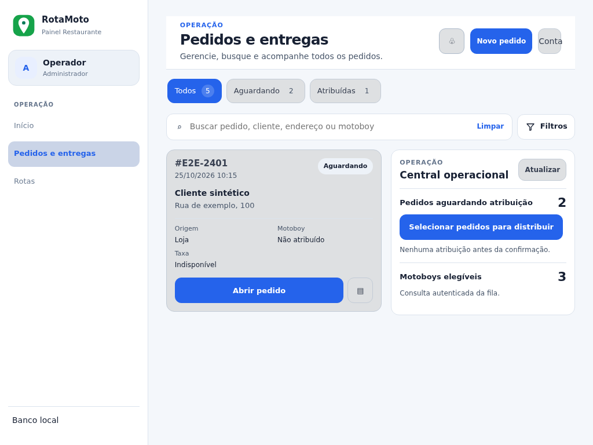
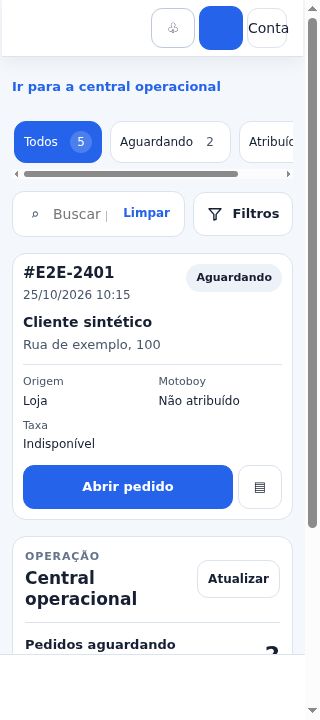
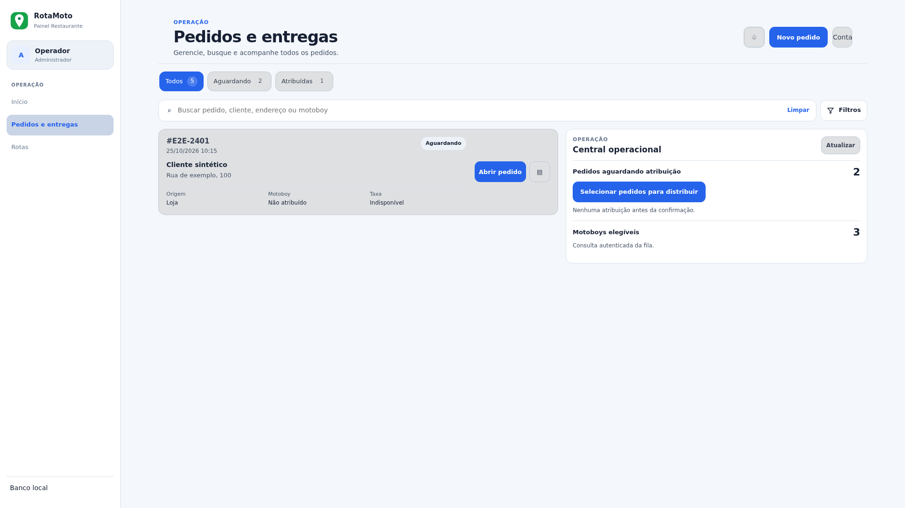

# Pedidos V2 — layout responsivo e Filtros (2026-10-25)

## Escopo e limite

CDP em Chromium 155 mediu o layout com os CSS de produção servidos em `127.0.0.1:8083`. A página foi renderizada como fixture visual sintética com sidebar expandida/recolhida; scripts da aplicação foram bloqueados e o service worker foi bypassado para isolar o CSS. A fixture não representa sessão autenticada nem comprova despacho, consulta de fila ou E2E operacional. Não foram usados dados reais nem chamadas de API.

Os assets carregados pelo navegador incluíram `styles.css?v=0304.8`, `design-system.css?v=0304.4` e `orders-v2.css?v=0304.7`. A versão do app e do cache do service worker foi conferida pelos testes estáticos e pela suíte, não por instalação do SW nesta fixture.

## Causa comprovada

O workspace só mudava para duas colunas em `@container orders-v2-page (min-width:920px)`. A 1024 px de viewport, a sidebar expandida deixava 706,56 px úteis para a página. Assim, apesar de a lista e a central caberem, a condição de 920 px mantinha os painéis empilhados e mostrava o atalho para a central.

A busca reservava uma coluna fixa de 44 px para o elemento `Filtros`; seu `summary` media 44×44 px e o rótulo não cabia.

## Correções

- O layout agora usa a largura da container `.orders-v2`, e não apenas o viewport: a partir de 680 px, Grid mantém no mínimo 340 px para a lista, 280 px para a central e 16 px de gap. A central cresce até 45% (máximo 640 px), permitindo aproximadamente 55/45 em áreas médias e cerca de 60/40 em áreas largas.
- Abaixo de 680 px os painéis empilham; o atalho para a central aparece apenas nesse estado. Em duas colunas ele fica oculto.
- `Filtros` passou a ter coluna mínima de 100 px e altura de 44 px, com texto sem quebra.
- Instruções repetidas foram encurtadas. A confirmação permanece explicitamente junto às ações de distribuição; seleção de pedido/motoboy continua delegando ao fluxo existente e requer confirmação.
- Atualizados os URLs versionados de `orders-v2.css` e `app.js`, o cache shell do service worker de `v111` para `v112` e as expectativas dos testes.

## Medidas comparativas

Valores em CSS px via `getBoundingClientRect()`. Sidebar expandida, tema claro; o conteúdo e o viewport são equivalentes entre as capturas. Antes e depois: distância do conteúdo do cabeçalho: 24 px em 1024 px, 28,16 px em 1280 px. O cabeçalho não foi alterado nesta correção.

| Viewport | Container útil | Antes: lista/central | Depois: lista/central | Gap | Atalho após |
|---:|---:|---|---:|---:|---|
| 320 | 281 | Empilhado | Empilhado | — | Visível |
| 390 | 351 | Empilhado | Empilhado | — | Visível |
| 600 | 244,88 | Empilhado | Empilhado | — | Visível |
| 768 | 473,94 | Empilhado | Empilhado | — | Visível |
| 1024 | 706,56 | Empilhado | 372,61 / 317,95 | 16 | Oculto |
| 1280 | 947,22 | 609,17 / 322,05 | 504,98 / 426,23 | 16 | Oculto |
| 1440 | 1097,63 | 708,44 / 373,19 | 587,70 / 493,92 | 16 | Oculto |
| 1920 | 1504 | 1108 / 380 | 848 / 640 | 16 | Oculto |

A sidebar recolhida também foi medida em 1024, 1280, 1440 e 1920 px nos dois temas: o workspace permaneceu em duas colunas. A largura útil a 1024 px subiu de 706,56 para 886,56 px com sidebar recolhida.

| Controle | Antes | Depois |
|---|---:|---:|
| Botão Filtros | 44×44 px; rótulo comprimido | 100×44 px; `scrollWidth <= clientWidth` |
| Painel de filtros aberto em 390 px | — | 340 px, dentro do viewport, sem overflow horizontal |

A busca inclui a medição completa por viewport/tema/sidebar em [`after-measurements.json`](after-measurements.json), a amostra anterior em [`before-measurements.json`](before-measurements.json) e a saída reproduzível em [`after-run.log`](after-run.log). O clique nativo no disclosure Filtros abriu o painel; o link de atalho em 390 px atualizou a âncora `#ordersOperations`. Não foi simulada navegação autenticada.

## Capturas

Antes (1024 px, painéis empilhados e Filtros comprimido):

Depois (mesma largura, duas colunas):

Depois (celular, botão Filtros com largura suficiente):

Depois (desktop amplo):

Capturas adicionais em 320, 390, 768, 1024, 1280 e 1920 px incluem temas claro/escuro; larguras >=1024 incluem sidebar aberta/recolhida. A referência visual aprovada não foi substituída por estas capturas.

## Validação

- `npm test` no Restaurante: **PASS**, suíte completa. Uma primeira execução apontou expectativas de versões de cache e do antigo breakpoint; os testes foram atualizados para as novas versões/regra e a execução final completa passou.
- `node --check app.js`, testes direcionados da central e do contrato responsivo, e `git diff --check`: **PASS**.
- CDP/fixture: **PASS técnico de layout** — 28 combinações de largura/tema/sidebar; sem overflow horizontal; filtros legíveis; duas colunas quando a container mede pelo menos 680 px.
- E2E autenticado/MFA e ações operacionais reais desta intervenção: **BLOCKED / não executado**. Não houve escrita em banco oficial.
- Fidelidade visual aprovada pelo proprietário: **FAIL / aguardando nova inspeção** (G14 permanece FAIL).
